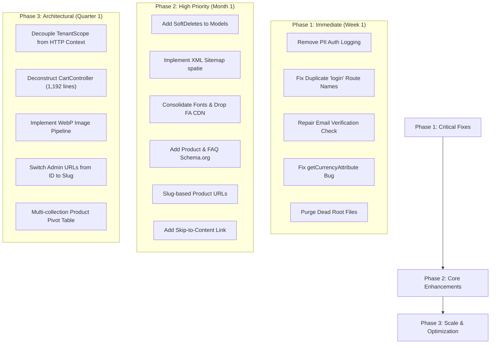

# MetoHub — Comprehensive Project Analysis & Issue Audit

**Generated:** October 18, 2026  
**Stack:** Laravel 12.44 / PHP 8.2 / MySQL  
**Scope:** Full codebase audit covering Code Quality, SEO, AEO (Answer Engine Optimization), Accessibility (WCAG 2.1), Performance, Security, Multi-Tenancy Architecture, and Database Design.  
**File Location:** `/Applications/XAMPP/xamppfiles/htdocs/Github/MetoHub/Task19-Grocery/z_issues.md`

---

## Executive Summary & Scorecard

| Category | Score | Status | Key Focus |
|---|---|---|---|
| **Code Architecture** | 7.5/10 | 🟡 Good foundation, specific gaps | Multi-tenancy context isolation, monolithic cart controller |
| **SEO** | 8.5/10 | 🟢 Strong implementation | Missing sitemap.xml, query-string product URLs, Schema.org |
| **AEO (AI Optimization)** | 7.0/10 | 🟡 Good start, room to grow | SoftwareApplication schema, llms.txt integration, FAQPage JSON-LD |
| **Accessibility (WCAG)** | 6.5/10 | 🟡 Partially conformant | Skip-to-content links, heading/summary semantic conflicts, ARIA |
| **Performance** | 6.0/10 | 🟠 Several risks identified | Multiple render-blocking Google fonts, full FontAwesome CDN, image pipeline |
| **Security** | 7.0/10 | 🟡 Solid CSRF/ORM, critical PII log | PII email logging in auth, skipped email verification, mass assignment risk |
| **Database Design** | 7.5/10 | 🟡 Solid, some scoping risks | Missing SoftDeletes, HTTP-coupled global scopes, 1:N collection limits |
| **UX / Conversion** | 8.0/10 | 🟢 Excellent landing page structure | Registration wizard, mobile responsiveness, premium feel |

---

## 1. Project Architecture Overview

### Tech Stack & Core Dependencies
- **Framework:** Laravel 12.44.0 (PHP ^8.2)
- **Database:** MySQL with session driver: `database`
- **Auth:** Laravel built-in `web` guard with custom tenant scoping
- **Payment Processing:** Razorpay (subscription billing and direct checkout)
- **PDF Generation:** `barryvdh/laravel-dompdf` (invoices, packing labels)
- **Push Notifications:** `minishlink/web-push`
- **OAuth:** `laravel/socialite` (Google OAuth)
- **Spreadsheets / Exports:** `phpoffice/phpspreadsheet`

### Multi-Tenancy Pattern
- **Shared database, isolated by `tenant_id`** via a global `TenantScope` applied automatically through the `BelongsToTenant` trait.
- A single Laravel application instance hosts:
  1. The central marketing SaaS landing page
  2. The super-admin platform administration panel
  3. $N$ merchant admin dashboards (`/{tenant}/admin` or custom subdomain/domain)
  4. $N$ customer storefronts across multiple template themes

### Project Scale
- **304 registered routes** (279 GET/POST endpoints)
- **33 Eloquent models**
- **37+ controllers** across `Admin`, `SuperAdmin`, `DeliveryBoy`, `SaaS`, and `API` namespaces
- **15 storefront themes** (3 active/primary: `template_1`, `template_2`, `template_3`)
- **66 storefront template blade files**
- **36 landing page blade files**

---

## 2. Code Quality & Codebase Issues

### ✅ Strengths
- Clear namespace separation across controllers (`Admin`, `SuperAdmin`, `DeliveryBoy`, `SaaS`, `API`).
- The `BelongsToTenant` trait cleanly boots a global scope, preventing repetitive manual `where('tenant_id')` filtering.
- Eager loading (`with(...)`) utilized across 168+ places in controllers to avoid N+1 query traps.
- Automated slug generation with collision prevention in both `Product` and `Tenant` models.
- Model accessors encapsulate business presentation logic (`starting_price`, `discounted_price`, `compare_at_price`, `main_image_url`).
- Dedicated service classes (`MarketingContent`, `MarketingSeo`) separate marketing/metadata business logic from controller request handlers.
- Standard CSRF protection on forms and parameterized ORM queries preventing SQL injection.

---

### 🔴 Critical Code Issues

#### Issue 1: Sensitive User PII Logged to Production Logs
- **File:** `app/Http/Controllers/Admin/AuthController.php` (lines 36–39, 55, 64, 76)
- **Problem:**
  ```php
  \Log::info('Login attempt', ['email' => $credentials['email']]);
  \Log::info('User authenticated', ['type' => $user->type, 'tenant' => $user->tenant_id]);
  ```
- **Impact:** User emails and credentials context are written to log files on every login attempt. This violates GDPR/privacy data minimization standards and poses security risks if logs are aggregated or leaked.
- **Resolution:** Remove all debugging `\Log::info` statements logging user credentials from `AuthController`.

#### Issue 2: `email_verification_required` Property Non-Existent / Silently Evaluates to False
- **File:** `app/Http/Controllers/Admin/AuthController.php` (line 42)
- **Problem:**
  ```php
  if (Auth::user()->email_verification_required && !Auth::user()->email_verified_at) {
  ```
- **Impact:** The column/attribute `email_verification_required` is not present in `User::$fillable` or standard migrations. In Eloquent, accessing an unmapped property yields `null`, evaluating `null && ...` to `false`. Email verification enforcement is silently bypassed.
- **Resolution:** Add `email_verification_required` boolean flag to the `users` table via migration and add it to `User::$fillable`, or standardize on standard Laravel `MustVerifyEmail` interface.

#### Issue 3: Duplicate Route Name `login`
- **File:** `routes/web.php` (lines 110, 121, 167, 175)
- **Problem:** Four different routes declare `->name('login')`.
- **Impact:** Laravel's route collection resolves `route('login')` to the last registered route (the fallback redirect). When the `auth` middleware intercepts an unauthenticated user, it redirects them inconsistently or into a loop instead of the intended tenant/admin login form.
- **Resolution:** Assign unique route names (e.g. `landing.login`, `tenant.admin.login`, `superadmin.login`).

#### Issue 4: Monolithic `CartController.php` (1,192 Lines)
- **File:** `app/Http/Controllers/CartController.php`
- **Problem:** Single controller manages session cart state, checkout calculations, coupon validation, delivery address persistence, order creation, and payment callbacks.
- **Impact:** High cyclomatic complexity, difficult unit testing, risk of regressions during checkout modifications.
- **Resolution:** Refactor into dedicated domain action services: `CartService`, `CheckoutService`, `CouponService`, `PaymentCallbackService`.

---

### 🟡 Moderate Code Issues

#### Issue 5: `TenantScope` Dependent on HTTP Request Context Inside Model Layer
- **File:** `app/Scopes/TenantScope.php` (or within `BelongsToTenant`)
- **Problem:** Directly relies on `request()->route('tenant')` and `session()`.
- **Impact:** Fails when models are invoked outside HTTP lifecycles (e.g., queued jobs, artisan commands, scheduled cron tasks). Models may either return empty results or accidentally leak unscoped data across tenants.
- **Resolution:** Extract a stateful singleton `TenantContext::get()` / `TenantContext::set()` populated by HTTP middleware or job initializers.

#### Issue 6: Repository Root Clutter and Dead Code
- **Problem:** Legacy and scratch files committed in version control:
  - `default.php.old.php` (16 KB backup)
  - `test_script_0.js`, `test_script_1.js`
  - `update_billing.py` (direct DB patch script bypassing Laravel migrations)
  - `output.txt`
- **Impact:** Technical debt and potential confusion during deployment/CI.
- **Resolution:** Delete unused files and add temporary extensions to `.gitignore`.

#### Issue 7: `getCurrencyAttribute` Overwrites Currency Code with Symbol
- **File:** `app/Models/Tenant.php`
- **Problem:**
  ```php
  public function getCurrencyAttribute($value) {
      $symbols = ['INR' => '₹', 'USD' => '$', ...];
      return $symbols[$value] ?? $value;
  }
  ```
- **Impact:** `$tenant->currency` returns `"₹"` instead of `"INR"`. Third-party APIs (like Razorpay) requiring the ISO currency code (e.g. `INR`) receive `"₹"`, leading to API payload validation rejections.
- **Resolution:** Rename accessor to `getCurrencySymbolAttribute()` and preserve raw ISO code on `$tenant->currency`.

#### Issue 8: `LandingController::handleDemoRequest` Always Responds with Success
- **File:** `app/Http/Controllers/LandingController.php`
- **Problem:** Catches mail exceptions and returns `['success' => true]` without alerting admins or queuing retries.
- **Resolution:** Log failure to monitoring/sentry and queue transactional emails via Laravel jobs with retry backoffs.

---

## 3. Search Engine Optimization (SEO) Analysis

### ✅ SEO Strengths
- Comprehensive `MarketingSeo` service dynamically generating:
  - Meta titles and meta descriptions
  - Robots directives (`index, follow` controlled via environment config)
  - Canonical tags (`<link rel="canonical">`)
  - Open Graph tags (`og:title`, `og:description`, `og:url`, `og:image`, `og:image:width`, `og:image:height`, `og:locale="en_IN"`, `og:site_name`)
  - Twitter Card tags (`summary_large_image`)
  - Article metadata on blog entries (`article:published_time`, `article:modified_time`, `author`)
  - `<link rel="describedby" href="/llms.txt">`
- Structured semantic heading hierarchy: Single `<h1>` on landing pages followed by orderly `<h2>` and `<h3>` tags.
- Descriptive `alt` attributes present across showcase imagery.
- External links configured with `rel="noopener noreferrer"`.

---

### 🟡 SEO Gaps & Action Items

#### SEO Gap 1: No Dynamic XML Sitemap (`sitemap.xml`)
- **Impact:** Search engines must rely purely on internal link crawling, causing delayed indexing of new landing pages, merchant profiles, and blog posts.
- **Resolution:** Install and configure `spatie/laravel-sitemap` to schedule automated sitemap generation.

#### SEO Gap 2: Product URLs Use Query-String Identifiers
- **Problem:** Storefront URLs rely on `/v1/product?id=23` or `/v3/product?id=23`.
- **Impact:** Search engines prioritize keyword-rich, canonical slug URLs (e.g., `/products/fresh-avocado-500g` or `/store/{tenant}/products/{product-slug}`). Query parameters have lower CTR and SEO weight.
- **Resolution:** Introduce slug-based routing for storefront products: `/{tenant}/product/{slug}`.

#### SEO Gap 3: Missing `Offer` / `PriceSpecification` Structured Data on Pricing Cards
- **Problem:** SaaS pricing cards lack Schema.org microdata/JSON-LD.
- **Impact:** Disqualifies MetoHub pricing from Google Rich Snippets for subscription searches.
- **Resolution:** Embed Schema.org `PriceSpecification` / `Offer` in the landing page JSON-LD block.

#### SEO Gap 4: Internal Demo Links Lack `rel="nofollow"`
- **Problem:** Demo store links on the landing page are internal sub-stores with sample data.
- **Impact:** Spreads search crawl budget into sample product catalogs instead of core marketing and documentation pages.
- **Resolution:** Add `rel="nofollow noopener noreferrer"` to all mock demo preview buttons.

#### SEO Gap 5: Missing Modern Responsive Image Formats (WebP/AVIF & `srcset`)
- **Problem:** Images served as raw uncompressed PNG/JPG without `<picture>` tags or responsive sizing.
- **Impact:** Degrades Largest Contentful Paint (LCP) and mobile page speed rankings.
- **Resolution:** Implement automatic WebP conversion and `srcset` generation during asset upload.

#### SEO Gap 6: Blog Feed Failure Returns HTTP 503
- **File:** `LandingController.php` (or blog controller)
- **Problem:** When an external or cached blog feed fails, the view returns HTTP 503 Service Unavailable.
- **Impact:** Repetitive 503 status codes cause search engine bots to deprioritize blog index crawling.
- **Resolution:** Cache previous feed responses and return stale cached content with a 200 OK code instead of 503.

#### SEO Gap 7: Legacy "Grocery" Theme Names in Theme Selection
- **File:** `config/storefront_themes.php`
- **Problem:** Templates are still labeled "Classic Grocery", "Fresh Market", "Quick Basket" in configuration.
- **Impact:** Conflicts with MetoHub's positioning as a universal multi-category SaaS ecommerce builder for luxury, electronics, fashion, and retail brands.
- **Resolution:** Rename themes to universal names (e.g., "Minimal Luxury", "Modern Showcase", "High-Velocity Retail").

---

## 4. Answer Engine Optimization (AEO)

AEO optimizes content ingestion for AI answer engines (ChatGPT Search, Perplexity, Google AI Overviews / SGE, Gemini, Claude).

### ✅ AEO Strengths
- **Native `llms.txt` Discovery:** Head tag includes `<link rel="describedby" href="/llms.txt" type="text/plain">`.
- **Natural Language FAQ Formatting:** Questions correspond directly to conversational conversational queries: *"Is it really ₹99/month?"*, *"Do I need to know how to code?"*.
- **Entity Definition Section:** Centralized `What is MetoHub?` section driven by `MarketingContent::summary()`.
- **AI Hallucination Safeguard:** Fictional sample customer reviews are annotated with `data-nosnippet`, preventing AI crawlers from citing demo names as real endorsements.

---

### 🟡 AEO Gaps & Action Items

#### AEO Gap 1: Validate Explicit `FAQPage` Schema.org Markup
- **Impact:** To be surfaced in Google AI Overviews and rich snippets, FAQs must be formatted as valid JSON-LD:
  ```json
  {
    "@context": "https://schema.org",
    "@type": "FAQPage",
    "mainEntity": [{
      "@type": "Question",
      "name": "Is it really ₹99/month?",
      "acceptedAnswer": {
        "@type": "Answer",
        "text": "Yes, MetoHub starts at ₹99 per month with zero setup fees."
      }
    }]
  }
  ```

#### AEO Gap 2: Missing `SoftwareApplication` / `WebApplication` JSON-LD
- **Impact:** AI engines cannot unambiguously categorize MetoHub as an e-commerce SaaS platform without software structured data.
- **Resolution:** Add `SoftwareApplication` JSON-LD containing `operatingSystem`, `applicationCategory: "BusinessApplication"`, and pricing offers.

#### AEO Gap 3: Missing `Organization` Schema on Company / About Pages
- **Impact:** AI bots fail to connect social media profiles (`sameAs`), founding info, and official headquarters with the brand entity.
- **Resolution:** Deploy `Organization` structured data with `name`, `url`, `logo`, `contactPoint`, and `sameAs`.

#### AEO Gap 4: Standardize `MarketingContent::summary()` for Direct Quotation
- **Requirement:** Ensure the first paragraph of `summary()` provides a concise, 2-3 sentence definition following the inverted pyramid format: *"MetoHub is an Indian multi-tenant SaaS e-commerce platform that allows D2C brands and Instagram sellers to launch branded online stores starting at ₹99/month."*

---

## 5. Accessibility Audit (WCAG 2.1 AA)

### ✅ Strengths
- Accessible carousel markup with `role="region"`, `aria-roledescription="carousel"`, and explicit `aria-label`.
- Carousel controls implement `aria-controls` and `aria-pressed`.
- Screen-reader text (`<span class="sr-only">`) attached to icons and external tab openers.
- Modal dialogs utilize native HTML5 `<dialog>` elements with proper focus traps.
- Wizard form errors bound to `role="alert"` and status steps announce via `aria-live="polite"`.
- Explicit `width` and `height` dimensions prevent layout thrashing (CLS).

---

### 🟡 Accessibility Gaps & Violations

#### A11y Gap 1: Missing Skip-to-Content Navigation Link (WCAG 2.4.1)
- **Problem:** `<main id="main-content">` is present, but no skip anchor exists at the start of `<body>`.
- **Impact:** Screen reader and keyboard-only users must tab through dozens of navigation links on every page refresh.
- **Resolution:** Add `<a href="#main-content" class="skip-to-content">Skip to main content</a>` styled offscreen until focused.

#### A11y Gap 2: Heading Nested Inside `<summary>` Element (Semantic Conflict)
- **Problem:**
  ```html
  <summary><h3 style="font: inherit; margin: 0">{{ $faq['question'] }}</h3></summary>
  ```
- **Impact:** `<summary>` has an implicit ARIA role of `button`. Placing an `<h3>` inside an interactive button element violates HTML specifications and confuses screen reader document outlines.
- **Resolution:** Replace the inner `<h3>` with `<span class="faq-question">`.

#### A11y Gap 3: Carousel Keyboard Arrow Navigation
- **Problem:** Previous/Next buttons exist, but native left/right keyboard arrow navigation is not consistently hooked up on the slide track.
- **Resolution:** Listen for `ArrowLeft` and `ArrowRight` keydown events on focused carousel containers.

#### A11y Gap 4: Pricing Tier Radio/Selection Grouping
- **Problem:** Pricing cards are isolated `<div>` cards without an overarching `role="radiogroup"` or `<fieldset>/<legend>`.
- **Resolution:** Wrap pricing selections in `<fieldset aria-labelledby="pricing-heading">`.

#### A11y Gap 5: Muted Typography Color Contrast
- **Problem:** Secondary text using `#6b7280` on subtle light gray cards (`#f9fafb`) yields ~4.4:1 contrast ratio, just under WCAG AA 4.5:1 minimum threshold.
- **Resolution:** Darken secondary text token to `#4b5563` or `#374151`.

---

## 6. Performance & Asset Delivery

### ✅ Strengths
- LCP hero image designated with `fetchpriority="high"`.
- Below-the-fold assets configured with `loading="lazy"`.
- Script files loaded asynchronously via `<script defer>`.
- Vite asset bundling with hash-based cache busting and asset versioning.
- Preconnect tags active for external Google Webfonts.

---

### 🔴 Performance Bottlenecks

#### Perf Issue 1: Redundant Google Fonts Loaded in Multiple HTTP Requests
- **Problem:**
  - Layout (`landing.blade.php`) loads `Instrument Serif` + `Manrope`.
  - Child template loads `Plus Jakarta Sans` + `Syne`.
- **Impact:** Two separate blocking CSS stylesheet network roundtrips to Google Fonts, causing 200–400ms rendering delay and FOUT/FOIT.
- **Resolution:** Consolidate into a single Google Fonts request or self-host fonts with `woff2` and `font-display: swap`.

#### Perf Issue 2: Full FontAwesome 6 CDN Library Loaded on Landing Pages
- **Problem:** `all.min.css` (~75KB gzipped, ~150KB webfont assets) loaded via CDN.
- **Impact:** The landing page only uses 4–6 small icons.
- **Resolution:** Replace FontAwesome CDN with lightweight inline SVG symbols.

#### Perf Issue 3: Missing Demo Store Product Eager Loading
- **Problem:** `LandingController::homepage()` retrieves demo tenants using `->keyBy('slug')` without chaining `with(['products' => fn($q) => $q->take(4)])`.
- **Impact:** Potential N+1 queries when looping through mock product cards.
- **Resolution:** Eager load related product collections in the controller query.

#### Perf Issue 4: Dynamic Calls to `MarketingContent` Uncached
- **Problem:** `MarketingContent::summary()` and `MarketingContent::faqs()` run on every landing page render.
- **Resolution:** Wrap responses in `Cache::remember('marketing_faqs', 86400, fn() => ...)`.

#### Perf Issue 5: No Server-Side Image Compression Pipeline
- **Problem:** Uploaded product pictures are stored directly in `storage/app/public/` and served as raw assets.
- **Impact:** Heavy payload transfers on mobile storefronts.
- **Resolution:** Integrate Intervention Image (`intervention/image`) to generate optimized WebP variants on upload.

---

## 7. Security & Authentication Audit

### ✅ Strengths
- Standard `@csrf` verification active on all state-modifying requests.
- Strict input validation via `$request->validate([...])` prior to controller execution.
- ORM parameterization preventing SQL injection.
- Explicit session invalidation and token regeneration on logout (`$request->session()->invalidate()`).
- Strong password minimum length rules enforced.

---

### 🔴 Security Vulnerabilities & Hazards

#### Sec Issue 1: Authentication Credentials Written to Application Logs
- **Location:** `app/Http/Controllers/Admin/AuthController.php`
- **Issue:** Email addresses explicitly dumped via `\Log::info`.
- **Remediation:** Remove logging of user-supplied authentication parameters.

#### Sec Issue 2: Email Verification Guard Inactive
- **Location:** `AuthController.php` (line 42)
- **Issue:** The boolean attribute `email_verification_required` is missing from the database, causing the verification check to always pass unverified users.
- **Remediation:** Implement column migration or use Laravel's standard `verified` middleware.

#### Sec Issue 3: Enumeration Risk via Integer Database IDs in URLs
- **Location:** Admin route declarations: `/{tenant}/admin`
- **Issue:** Passing numeric auto-increment primary keys in the URL allows attackers to scrape and enumerate tenant accounts.
- **Remediation:** Bind routes to `{tenant:slug}` instead of internal primary keys.

#### Sec Issue 4: Potential Mass Assignment on Subscription Columns
- **Location:** `Tenant.php` `$fillable` array includes `razorpay_customer_id`, `razorpay_subscription_id`, `subscription_status`.
- **Issue:** If any admin profile update controller executes `$tenant->update($request->all())`, an unprivileged user could forge subscription status values.
- **Remediation:** Strip subscription status columns from `$fillable` or protect updates with `$request->only(...)`.

#### Sec Issue 5: Environment Variable Formatting (`SESSION_DOMAIN=null`)
- **Location:** `.env`
- **Issue:** `SESSION_DOMAIN=null` sets the session domain to literal string `"null"` rather than PHP `null`, creating cross-subdomain cookie issues.
- **Remediation:** Change to empty assignment: `SESSION_DOMAIN=`.

---

## 8. Database Architecture & Multi-Tenancy

### ✅ Strengths
- Tenant isolation enforced via global scopes (`BelongsToTenant`).
- Explicit type casting (`$casts`) configured for booleans, dates, arrays, and JSON fields across models.
- Dedicated transactional billing ledger models: `StoreSubscription`, `SubscriptionInvoice`, `SubscriptionPayment`.

---

### 🟡 Database Schema Deficiencies

#### DB Issue 1: Missing Soft Deletes on Essential Models
- **Problem:** `Product`, `Order`, `Tenant`, and `User` lack the `SoftDeletes` trait.
- **Impact:** Deleting a product with past order items causes referential integrity failures or broken order history displays. Deleting a tenant causes permanent, immediate data loss.
- **Resolution:** Add `use SoftDeletes;` and `$table->softDeletes();` migrations.

#### DB Issue 2: HTTP-Coupled `TenantScope` Breaks in Queues & CLI Commands
- **Problem:** `TenantScope` executes `request()->route('tenant')` and `session('tenant_id')`.
- **Impact:** Fails in background jobs, order notifications, and Artisan commands where HTTP requests and sessions do not exist.
- **Resolution:** Implement a decoupled `TenantContext` service.

#### DB Issue 3: 1:N Rigid Collection Assignment on Products
- **Problem:** `products` table has a direct `collection_id` foreign key.
- **Impact:** A product cannot belong to multiple collections simultaneously (e.g. "Summer Sale" and "Fresh Produce").
- **Resolution:** Migrate to a many-to-many pivot table: `collection_product`.

---

## 9. Storefront Templates Status

| Template ID | Config Name | Responsive State | Schema.org | Cart & Checkout UX | Action Needed |
|---|---|---|---|---|---|
| `template_1` | Classic Grocery | Fixed mobile nav | ❌ Missing | 🟡 Basic | Redesign for modern luxury/D2C feel |
| `template_2` | Fresh Market | Fixed mobile nav | ❌ Missing | 🟡 Basic | Refresh styling tokens |
| `template_3` | Quick Basket | Sticky bottom bar | ❌ Missing | 🟢 Enhanced | Good foundation; add product schema |
| `template_4`–`15` | Stubs / Themes | Variable | ❌ Missing | ❓ Unaudited | Review and normalize |

---

## 10. Prioritized Roadmap & Action Items



### Phase 1: Critical Immediate Fixes (Week 1)
1. **Remove PII Logging:** Delete `\Log::info` statements with user email in `Admin/AuthController.php`.
2. **Fix Route Name Clashes:** Rename duplicate `login` route names in `routes/web.php` to prevent auth bounce loops.
3. **Fix Email Verification Bug:** Add `email_verification_required` column migration or align with Laravel `MustVerifyEmail`.
4. **Fix Currency Accessor:** Rename `getCurrencyAttribute` in `Tenant.php` to `getCurrencySymbolAttribute`.
5. **Clean Repository Root:** Delete `default.php.old.php`, `test_script_*.js`, and scratch files.

### Phase 2: High Priority Improvements (Month 1)
6. **Soft Deletes:** Add `SoftDeletes` trait and migrations to `Product`, `Order`, `Tenant`, `User`.
7. **Automated XML Sitemap:** Add `spatie/laravel-sitemap` and schedule daily generation.
8. **Font & Icon Optimization:** Consolidate landing page Google font requests into 1 call; replace FontAwesome CDN with SVGs.
9. **Structured Data:** Embed `Product` schema in storefronts and `SoftwareApplication` + `FAQPage` schema on landing pages.
10. **Slug-Based Product Routing:** Replace `/v3/product?id=23` with SEO-friendly `/{tenant}/products/{slug}` routes.
11. **WCAG Compliance:** Add a skip-to-main-content link and replace `<summary><h3>` with `<summary><span>`.

### Phase 3: Architectural & Scale Optimizations (Quarter 1)
12. **Decouple Multi-Tenancy:** Refactor `TenantScope` to use a singleton `TenantContext` service safe for background queues and CLI commands.
13. **Refactor Cart Controller:** Break down the monolithic 1,192-line `CartController` into focused domain services.
14. **Automated WebP Processing:** Introduce on-the-fly or upload-time WebP optimization and responsive `<picture>` tags.
15. **Tenant Route Slugs:** Change admin URLs from `/{tenant_id}/admin` to `/{tenant_slug}/admin`.
16. **Product Collection Pivot:** Migrate 1:N collection relationship to a many-to-many `collection_product` table.

---
*Report fully compiled into `z_issues.md` for team tracking and execution.*
